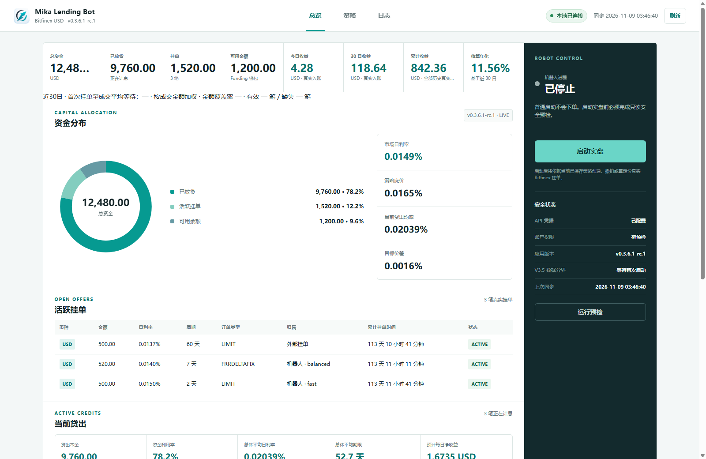

# Mika Lending Bot · Bitfinex USD 自动放贷

[](https://github.com/litianyu529-stack/mika-bitfinex-lending/actions/workflows/windows-verify.yml)
[](https://github.com/litianyu529-stack/mika-bitfinex-lending/releases/latest)
[](LICENSE)

在 Windows 上自动管理 Bitfinex USD Funding。用本地控制台查看余额和挂单，为短、中、长期限设置最低净年化和资金上限。遇到断线或交易结果不明时，机器人先暂停写入，再核对订单状态。

*Automated Bitfinex USD funding for Windows with a local dashboard, configurable lending limits, and order reconciliation.*

**[下载 v0.3.6.1-rc.1 预览版](https://github.com/litianyu529-stack/mika-bitfinex-lending/releases/tag/v0.3.6.1-rc.1)** · [下载正式版](https://github.com/litianyu529-stack/mika-bitfinex-lending/releases/latest) · [Windows 快速开始](#快速开始) · [反馈问题](https://github.com/litianyu529-stack/mika-bitfinex-lending/issues)



*控制台总览 · 演示数据*

- **控制资金与利率**：为三个期限池设置最低净年化，并限制可参与放贷的金额。
- **先对账再恢复**：提交或撤单结果不明时，核对交易所记录后才继续写入。
- **本地管理**：控制台仅监听本机，默认暂停，实盘需要预检和人工确认。

> [!WARNING]
> 实盘模式会在 Bitfinex 执行真实资金操作。首次使用请先在暂停模式核对 API 权限、资金上限和最低净年化。

本分支对应 `0.3.6.1-rc.1` 预览版，包含两小时手动订单保护和 Schema 19。默认使用 V3.5 报价机制。

## 安全边界

- 仅支持 `USD`，期限限定为 Bitfinex Funding 的 2–120 天。
- API 必须允许 wallets 读取、funding 读取/写入；withdraw 与 ui_withdraw 写权限必须关闭。
- 机器人只撤改 SQLite 中能够证明归属的挂单。V3.5 对外部 fUSD 挂单执行两次至少间隔 30 秒且账户守恒的权威快照确认，确认后自动托管并只按具体 Offer ID 撤销；手动新挂／修改订单按交易所操作时间保护 120 分钟，再次手动修改重新计时，正常部分成交不重置；强制安全规则可提前处理。详见 [手动订单保护](docs/manual-order-protection.md)。外部 Credits 不接管、不关闭。
- 短/中/长目标按当前托管未成交挂单与可用余额计算；已成交 Credits 计入资金上限，并参与已归属层级的目标缺口。超配池或期限通过后续新增资金逐步收敛，比例变化本身不会撤销已有有效订单。
- 提交、撤单和钱包转账统一区分 `CONFIRMED / DEFINITE_REJECT / UNKNOWN`。请求发出后的超时、断线、截断响应、非法 JSON 或提交成功但缺少 Offer ID 都属于 `UNKNOWN`；先停止写入并对账，不会盲目重复请求。
- 除人工暂停/停止外，网络、认证、配置、市场数据、账户数据、程序异常和 Worker 重启故障都会统一进入 PAUSED 的只读恢复循环，并在两次完整 REST 同步（至少间隔 30 秒）后自动恢复此前模式。不确定撤单会用 Offers 快照确认存在或消失后恢复；不确定提交会用请求时间附近的 Offers、Funding Trades 和历史 Offers 唯一绑定，或在两次权威快照确认不存在后关闭。多个候选会持续自动对账，但在无法唯一确认前绝不重新写入。
- WebSocket 每代连接必须重新收到 Book、Wallet、Offers、Credits 快照；新 Book snapshot 会清空上一代盘口。快照未齐全时只能使用新鲜 REST 完整降级数据。
- Dashboard 只绑定 `127.0.0.1:8000`。所有 POST 要求同源 Host/Origin、随机 CSRF 头、JSON Content-Type，且请求体不超过 64 KiB。
- SQLite 使用显式 Schema 19 和 V3 家族标记，16／18 可增量迁移，旧 V4 的 17 继续拒绝。升级前在线备份，迁移在事务中完成；人工 PAUSED 状态不会因迁移自动启动。

详细流程见 [安全恢复手册](docs/safety-recovery.md) 和 [架构说明](docs/architecture.md)。

V3.2 的无人值守恢复边界、退避、双快照确认和 Worker 心跳守护见 [V3.2 自动自愈说明](docs/v3.2-unattended-recovery.md)。

V3.3 的全市场需求分配、150 USD 低需求池保留、小额余额合并复投与外部挂单接管见 [V3.3 策略说明](docs/v3.3-demand-allocation.md)。

V3.5 合并了无人值守安全恢复与精确期限定价升级；0.3.5.2 起，快速层与平衡层共享同期限起价和固定市场落点，但使用独立的约两倍速调价时间表。固定市场落点、单向阶段调价和最终底线规则见 [V3.5 发布说明](docs/v3.5-release.md)。

V3.6 增加后台七天行情统计、真实事件回测和独立快速层起价；旧配置默认继续 V3.5。启用候选必须有绑定完整策略指纹的验收证书，已有订单保留原调价链。详见 [V3.6 发布与验收](docs/v3.6-release.md)。

状态库会从首笔精确期限探索订单向前关联其所在 LIVE 会话，以该会话启动时间作为 V3.5 数据分界；没有旧数据的新安装使用首次 V3.5 启动时间。状态接口提供更新前后等长窗口的挂单数、成交数、金额、加权日利率和加权等待时间，普通重启不会重置分界。

## 快速开始

运行环境：Windows、Python 3.12（CI 验证版本）和 Node.js 22（仅开发验证需要）。

下载预览版 Release 的 `Source code (zip)`，解压后在目录中打开 PowerShell。

```powershell
python -m pip install -r requirements.txt
Copy-Item default.cfg.example default.cfg
```

建议通过环境变量提供凭据：

```powershell
$env:BITFINEX_API_KEY = "your-key"
$env:BITFINEX_API_SECRET = "your-secret"
```

在 `default.cfg` 中设置三个期限池的最低净 APR；它们没有默认值，缺失时 LIVE 会被阻止。`max_lend_amount`、`max_lend_percent`、最低净 APR、最低订单金额和权限要求始终是硬边界。

## 运行

启动本地控制台：

```powershell
python lendingbot.py --dashboard
```

浏览器打开 [http://127.0.0.1:8000/lendingbot.html](http://127.0.0.1:8000/lendingbot.html)。停止 Worker 不会撤销已有挂单。

直接启动 LIVE（预检后还需输入一次 `LIVE`）：

```powershell
python lendingbot.py --live
```

单周期验证：

```powershell
python lendingbot.py --live --once
```

## 离线命令

这些命令拒绝在 LIVE 锁被占用时运行，且不会调用任何交易写接口。

```powershell
# 仅执行一次旧托管挂单归属迁移；重复运行幂等
python lendingbot.py --migrate-legacy

# 分页回填至少 90 天 fUSD Funding Trades 与 Stats
python lendingbot.py --backfill-market-data --research-days 90

# 固定 60 天训练、15 天验证、15 天测试
python lendingbot.py --evaluate-strategy --research-days 90 --principal 10000
```

历史盘口无法回填；新快照记录真实采样时间，旧分钟桶在桶结束后可见。V3.6 连续事件回测固定比较 A（旧输入与报价）、B（完整七天及分期限清洗）、C（B 加快速层 0.10 个净年化百分点探索）。12 组执行情景均须在验证、测试中胜出，并通过三天移动块 Bootstrap 95% 下界门槛；缺口和不可判定项目完整披露。报告写入 `.state/research/strategy-validation-report.json`。未通过时保留原机制，详见 [V3.6 发布与验收](docs/v3.6-release.md)。

手工评分权重不再由普通控制台或配置文件编辑，它们属于版本化研究实现。

## 验证

```powershell
python -m pip install -r requirements-dev.txt
.\verify.ps1
```

验证包括 Ruff、Python 编译、单元/集成回归测试、核心安全覆盖率、前端语法、Dashboard HTTP 关键流程和 `git diff --check`。测试通过临时 `AppContext` 隔离真实锁、默认数据库、日志和凭据，即使真实 Worker 正在运行也不会读取或写入其状态。

## 版本与文件

- 应用/User-Agent：`0.3.6.1-rc.1`
- Dashboard：按内容生成 build hash
- 核心入口：`lendingbot.py --dashboard`、`lendingbot.py --live`
- 状态库：`.state/lendingbot-v3.sqlite3`
- 发布记录：[GitHub Releases](https://github.com/litianyu529-stack/mika-bitfinex-lending/releases)
- 运行架构：[docs/architecture.md](docs/architecture.md)
- 异常处置：[docs/safety-recovery.md](docs/safety-recovery.md)
- 策略证据标准：[docs/strategy-validation.md](docs/strategy-validation.md)
