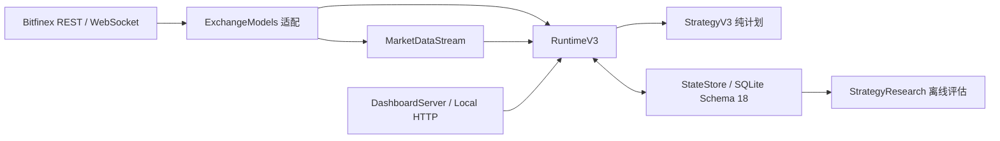

# 架构说明

## 边界

项目只服务单机、单账户、USD Funding。`lendingbot.py` 保留兼容 CLI 和应用组装；交易所数据形状集中在 `ExchangeModels.py`；显式领域类型位于 `DomainTypes.py`；路径和运行依赖由 `AppContext.py` 提供。

核心模块：

- `Configuration.py`：配置解析、V3 策略版本持久化、备份与校验。
- `DashboardServer.py`：本地 HTTP 安全边界、静态资源和路由；业务操作通过显式回调注入。
- `bitfinex.py`：REST 鉴权、公开读取和三态写入结果。
- `MarketDataStream.py`：WebSocket 连接代次、快照门槛及 REST 降级。
- `StrategyV3.py`：纯策略信号、计划与无写入回放。
- `RuntimeV3.py`：账户同步、安全状态机和执行编排。
- `StateStore.py`：Schema 19、订单意图、外部挂单接管及手动订单两小时保护、成交归属、恢复和研究数据。时间范围清理与成交等待查询使用独立索引；已初始化的数据库后续打开保持只读初始化路径。
- `MarketHistory.py`：统一批量行情入口、覆盖区间核验、SQLite 流式恢复及不可变七天统计快照。
- `EventReplay.py`：纯离线一分钟事件引擎，持续保留占款、挂单、贷款与日结利息。
- `StrategyResearch.py`：90 天连续 A/B/C 对照、12 组情景、60/15/15 指标切分及配对移动块 Bootstrap。
- `V36Validation.py`：绑定完整策略指纹的验收证书，按原始证据摘要重新检查全部门槛。

## 数据流

跨层新增接口应优先使用 `AccountSnapshot`、`MarketSnapshot`、`StrategyPlan` 和 `WriteResult`，避免继续扩散形状不确定的字典。Bitfinex 原始数组只允许出现在适配器边界。

## 状态与归属

订单写入从 `PLANNED → SUBMITTING → CONFIRMED/CLOSED/AMBIGUOUS`。`write_phase` 记录是否可能已经发往交易所，`resolution` 记录恢复结论，`strategy_variant` 记录基线或候选归属。只有确认绑定 `exchange_offer_id` 的订单才成为机器人托管订单。

运行模式为 `PAUSED / LIVE / REPLAY / APPLYING`。所有停止写入的情况统一显示为 `PAUSED`。除人工暂停外，所有故障均按退避执行只读恢复；不确定撤单通过重复 Offers 快照对账；不确定提交通过请求时间附近的 Offers、Funding Trades 和历史 Offers 对账。唯一匹配或稳定确认不存在时恢复此前模式；多重候选持续自动对账，但在证据唯一前保持只读。保护原因仍单独持久化，不会因为合并状态而放宽写入条件。

V3.6 的 LIVE 决策只读取后台发布的小型快照；七天恢复、清洗和公共分页均在后台执行。WS 与 REST 共享成交 ID 去重和批量落库，历史接口读取共享限速。完整覆盖证据、60 秒新鲜度或验收证书任一缺失时，新单沿用 V3.5。原始成交、盘口、统计保留 90 天，派生分钟统计与增量脏标记保留 8 天，研究信号临时缓存随研究上下文结束删除。
